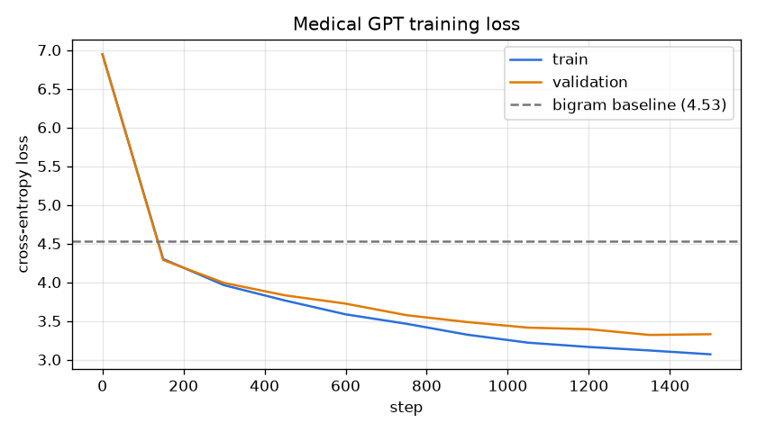

# Medical Terminology Helper

[](https://ask.thili.ai/b/xka8hhccyz)
[](https://github.com/dakshitha0705/medical-terminology-helper/actions/workflows/ci.yml)

A command-line assistant that completes medical phrases and definitions, powered by a **GPT built
from scratch** — my own byte-pair tokenizer and transformer — trained on four public-domain
anatomy and physiology textbooks, in under 10 minutes on a laptop CPU. No API, no key, no GPU.

> ⚠️ **Educational use only — not medical advice.** The model is tiny and learned from 1870–1911
> textbooks. Its output is often wrong or made up. It's for practising terminology, and it shows how a
> GPT works inside.

## Setup

Python 3.12+ and git.

```bash
python -m venv .venv
source .venv/bin/activate          # Windows: .venv\Scripts\activate
pip install -r requirements.txt    # CPU-only torch, matplotlib, pytest
```

No `.env` is needed. `.env.example` lists two optional overrides (`MODEL_PATH`, `DATA_PATH`).

## Train it (about 10 minutes, once)

```bash
python scripts/prepare_data.py     # download + clean 4 books -> data/ (1.1M characters)
python scripts/tokenize_corpus.py  # optional: BPE report -> results/tokenizer_report.md
python scripts/train.py            # ~8 min on CPU -> models/medgpt.pt, results/loss.png
python scripts/make_samples.py     # optional: results/samples.md
```

`models/` and `data/` are git-ignored. The checkpoint holds the weights, config and tokenizer, so
you only train once.

## Use it

```bash
python -m app.cli complete "The femur is"
python -m app.cli complete "The heart is a hollow muscular organ" --length 40 --temperature 0.6 --top-k 20
python -m app.cli define "tachycardia"
python -m app.cli interactive      # type partial phrases; `define <term>`, :len 30, :temp 0.7, :quit
python -m app.cli info             # model size and scores
python -m app.cli history          # your recent prompts
```

Options for `complete`, `define` and `interactive`: `--length/-n` (tokens, 1–500),
`--temperature/-t` (> 0), `--top-k/-k` (0 = off), `--top-p/-p` (0 = off), `--seed`, `--model`.

The CLI explains its errors in plain language:

| You do | It says |
|---|---|
| run before training | `No trained model at models/medgpt.pt. Train one first: python scripts/prepare_data.py / python scripts/train.py` |
| send an empty phrase | `please type a phrase or term (the input was empty)` |
| type `♥` or `@` | `the model has never seen these characters: ♥ (U+2665)` |
| type curly quotes or accents (`“café”`) | quietly normalised to `"cafe"` and completed |
| pass `-t 0` | `argument --temperature/-t: must be > 0 and <= 5` |

## How it works

| Milestone | What | Where |
|---|---|---|
| 1. Corpus | 4 Project Gutenberg books → strip licence, front matter, indexes, figure captions, tables, review questions → ASCII → 2,756 paragraphs (1,098,479 chars, 192k words), 91/9 train/val split. Cutter's glossary is kept as 428 `Term: definition` lines. | [`app/core.py`](app/core.py), [`scripts/prepare_data.py`](scripts/prepare_data.py), [DATA.md](DATA.md) |
| 2. Tokenizer + embeddings | BPE from scratch: 80 characters + 920 merges = **1,000 tokens**, **3.04 chars/token**, exact round trip. Token + positional embeddings. | [`results/tokenizer_report.md`](results/tokenizer_report.md) |
| 3. Transformer | Hand-written masked scaled dot-product attention (no `nn.MultiheadAttention`), 4 heads, feed-forward, pre-norm residual blocks | `Head`, `MultiHeadAttention`, `Block`, `GPT` |
| 4. Training | AdamW + cross-entropy, cosine LR decay. Times 20 steps, then sizes the run to the time budget | [`scripts/train.py`](scripts/train.py) |
| 5. Generation | temperature, top-k, top-p, length, seed, stop-at-sentence; `define` mode uses the glossary format `Term:` | `complete`, `define` |
| 6. CLI | one-shot + interactive loop, friendly errors, history in `data/app.json` | [`app/cli.py`](app/cli.py) |

Words split like this:
`pericardium` → `' per' · 'ic' · 'ard' · 'ium'`, `tachycardia` → `' t' · 'ach' · 'y' · 'c' · 'ard' · 'ia'`,
`diaphragm` → `' diaphragm'` (frequent enough to be a single token).

## Results

Model: 4 layers, 4 heads, 128-dim embeddings, 128-token context, **1,065,192 parameters**.
Trained for 1,500 steps × 32 sequences (263 ms/step) in **8.8 minutes** on a laptop CPU.



| model | validation loss | perplexity |
|---|---|---|
| uniform guess over 1,000 tokens | 6.908 | 1000 |
| bigram counts (baseline) | 4.530 | 92.8 |
| **this GPT** | **3.328** | **27.9** |

Sample outputs (seed 0; more in [results/samples.md](results/samples.md)):

```text
The femur is inserted into the cribula, which passes into the internal maxillae, while the cra-ficus
The heart is a hollow muscular organ, and the heart, the blood, the heart, which is drawn from the
veins. The walls of the pulmonary veins, and veins, which are the capillaries, the heart
Tachycardia: A term applied to the internal ear.
```

## What it learned, and its limits

- **Learned:** the vocabulary and style of the textbooks. Real anatomical terms appear in
  plausible places (ventricle, capillaries, cerebrum, ligaments, pulmonary veins), and the
  glossary's way of opening a definition ("A term applied to …").
- **Didn't learn:** facts. It's a 1M-parameter model trained on about 330k tokens for 8 minutes, so
  completions read like 1900s textbook prose but are usually wrong. It also invents words
  ("cribula", "calseale").
- **`define`** gives the same generic glossary sentence for every term. 428 definitions are too few
  for it to link terms to meanings.
- The books are 1870–1911, so even the source text is outdated in places.
- Next steps would be more text, more parameters, longer training, or adding retrieval over the
  glossary.

## How it builds on my "Build GPT from Scratch" drill

The drill (`mini_gpt.py`, notebooks 04–09) trained a 160k-parameter, **character-level** GPT on
Shakespeare in 400 steps. This project reuses its `Head` → `MultiHeadAttention` → `FeedForward`
→ `Block` → `GPT` code almost line for line, and its lesson-8 sampler (temperature / top-k / top-p).
New here:

- the data is real, cleaned from raw books;
- a **BPE tokenizer** written from scratch replaces the 65-character vocabulary (3× more text per context window);
- the model is configurable (`GPTConfig`), uses dropout and GPT-2-style init, and is ~7× bigger;
- training runs to a time budget, with cosine LR decay, a bigram baseline, a loss plot and a single
  checkpoint (weights + config + tokenizer) that the app loads without retraining;
- prompt-based completion, a definition mode, and a tested CLI with error handling.

## Tests

```bash
pytest -q
```

The tests run on GitHub Actions with no dataset, no trained model and no API key. They use tiny
made-up text and tiny random models to check corpus cleaning, BPE round trips, that the causal mask
hides the future, tensor shapes, that the untrained loss ≈ log(vocab), that training lowers the loss,
checkpoint save/load, the sampling options, and CLI parsing and errors.

## Data credits

Texts from [Project Gutenberg](https://www.gutenberg.org), all public domain in the USA:
Annette Fiske, *Structure and Functions of the Body* (1911, #64754); Calvin Cutter, *A Treatise on
Anatomy, Physiology, and Hygiene* (1870, #30541); Edward S. Ellis, *Ellis's Primary Physiology*
(1900, #52775); Michael Foster, *Physiology* (Science Primers, 1880, #53347). Details and cleaning
steps are in [DATA.md](DATA.md).
